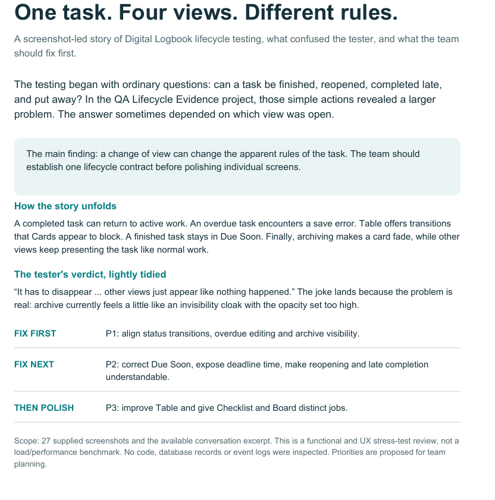
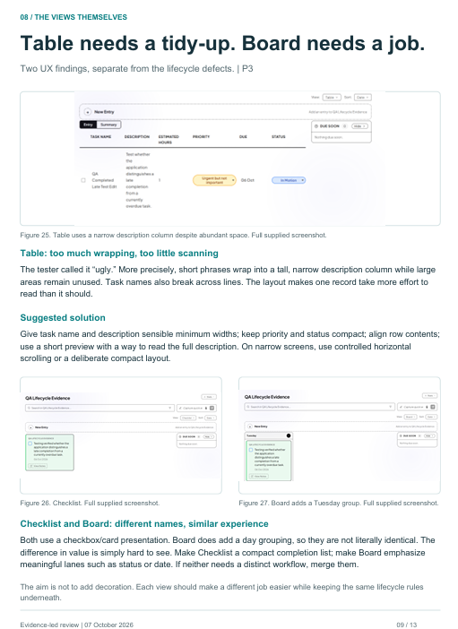
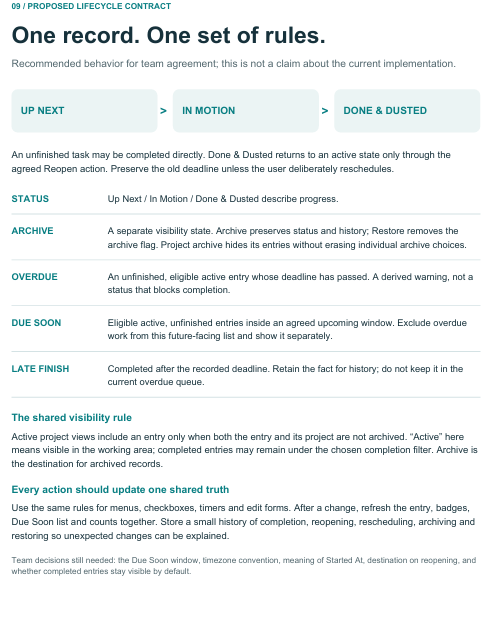
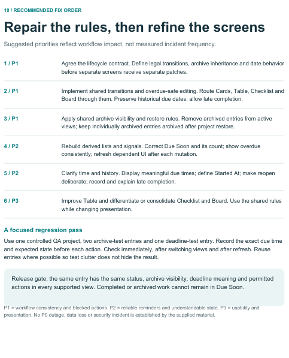

## Meeting 14 — 1 October 2026

**Venue:** Wartenweiler Library — Focus Room 2
**Attendees:** Hlulani Baloyi, Siphesihle Merile, Lupa Martins, Sicelo Vanyelwa, Zamokuhle Maziya, Nasiphi Ntontela (full team)

**Context:** First internal meeting of Sprint 4, held two days after the Sprint 3 review on Tuesday, 29 September 2026. The team reflected on Sprint 3's outcomes and planned the run-up to the final presentation and submission.

**What we did:**

### 1. Reflection on the Sprint 3 review

- Reviewed the Sprint 3 review experience together, discussing what had worked well in the sprint — the recovered testing pipeline, the UI reorganization, and the breadth of features demonstrated — and where the application still needed refinement before final submission.
- Identified the main lessons from the review: late-breaking regressions and inconsistent behaviour damage a demonstration more than a missing feature does, and stability now matters more than adding new scope.
- Agreed that Sprint 4 should focus on **stable, consistent behaviour rather than introducing unnecessary new features**, and on addressing known feedback before the final submission rather than leaving it undocumented.

### 2. Final presentation preparation

- Discussed the structure of the final presentation: opening with the application's purpose, walking through the core workflow, and closing with the development journey across the four sprints.
- Identified which system features should be demonstrated — sign-in and onboarding, project and entry creation, the calendar and other entry views, statistics, and the timer — and which team members would speak to each area.
- Discussed the importance of a clear, honest explanation of the application and its development journey, highlighting the progress from the earlier sprints.
- Agreed to avoid unreliable demonstrations: the demo environment and demo data must be prepared and verified beforehand so the presentation does not depend on live first-time behaviour.

### 3. Outstanding fixes and testing

- Reviewed the known bugs and rough edges carried over from Sprint 3.
- Agreed to prioritise **high-impact functionality** over cosmetic items for the remaining time.
- Discussed testing **whole workflows rather than isolated screens** — for example creating, completing, editing and archiving an entry across the different views — to reduce regressions.
- Identified UI clarity improvements to prepare the application for final evaluation.

### 4. Group report and individual reports

- Discussed the structure and timing of the final group report and the individual reports, including each member's contribution record.
- Agreed on the importance of **accurate evidence of each person's work**, kept consistent with the Git history, the Trello boards and the documented meeting and feedback records.
- Planned enough time for report review and final submission rather than leaving writing to the last days.

### 5. Improving user feedback

- Discussed how to improve the feedback process for the final round: better question quality, clearer documentation of observations, and linking each piece of feedback to a specific improvement or decision.
- Agreed that feedback evidence — screenshots and supporting material — should be captured and published on the documentation site, as was done for the Sprint 2 round.
- Discussed how the findings would feed directly into the final polishing work.

**Decisions made:**

- Sprint 4 scope is final polishing, stabilization and presentation/report readiness — no new feature-expansion phase.
- Demo environment and demo data to be prepared and verified before the final presentation.
- Testing effort to focus on end-to-end workflows and regression reduction.

**Next step decided:**

- Members continue their outstanding Sprint 3 follow-up work (timer reliability, notifications, documentation) while the feedback round is run and its results are documented.

---

## Meeting 15 — 8 October 2026

**Venue:** Wartenweiler Library — Focus Room 2
**Attendees:** Hlulani Baloyi, Siphesihle Merile, Lupa Martins, Sicelo Vanyelwa, Zamokuhle Maziya, Nasiphi Ntontela (full team)

**Context:** Functional and UX stress-test review of the Digital Logbook. The team worked through the findings of the
**Digital Logbook Stress Test Report (7 October 2026)** — a 13-page functional
and UX review analysing 27 supplied screenshots — one day after the report was
produced. This was **not** a load or performance benchmark: no outage, data
loss or security incident is established by the report, and no backend logs or
code-level diagnosis were inspected for it.

**What we did:**

### 1. Cross-view inconsistency

- Reviewed the report's central finding — that the same entry could appear or behave differently across the Cards, Table, Checklist and Board views: status transitions, completion and reopening, which controls are available, whether overdue warnings appear, and whether archived entries are visible.
- Discussed why a **single underlying lifecycle model** matters: a view may arrange information differently, but it must not reinterpret the rules. Every view should offer the same status, the same permitted actions and the same deadline indicators for the same entry.

### 2. Overdue editing and task completion

- Reviewed the report's documented difficulty editing an overdue entry because the entry's own existing deadline was rejected as a past date on save.
- Discussed the importance of allowing users to **complete or edit overdue work without rewriting historical deadlines**: a due date that is already in the past is information about unfinished work, not a reason to lock the editor.
- Distinguished **overdue status** — a derived warning — from a **restriction on user actions**: the overdue state should never remove the controls needed to finish the work.

### 3. Due Soon inconsistencies

- Reviewed the report's example in which an entry remained in Due Soon even after being marked Done & Dusted, with the sidebar entry and count persisting.
- Discussed the requirements that follow from it:

  - completed, archived and overdue entries must be excluded from Due Soon;
  - list contents and counts must stay synchronized;
  - derived information must refresh after every entry change;
  - state must be rechecked after a browser refresh to confirm persistence.

### 4. Archive visibility and restoration

- Reviewed the report's findings that archived entries could remain visible in active views — faded in Cards, but ordinary-looking in the Table, Checklist and Board.
- Discussed the difference between **individual entry archive** and **project archive**: restoring a project should not silently restore entries that had been independently archived beforehand, and archive history should remain accessible from the Archives area.
- Agreed that archive behaviour must be tested in every view, not only the view it was triggered from.

!!! note "Evidence limitation (preserved from the report)"
The report presented the project-restore preservation problem — whether
restoring a project also restores independently archived entries — as **a risk
to be verified with a controlled retest**, not as independently proven data
loss. The report's evidence did not record every entry before and after a
restore, so this item was treated as a test requirement, not a confirmed
defect.

### 5. Deadline time and completion history

- Reviewed the report's observation that the edit form displayed an exact due time (e.g. `2026/10/06 22:10`) while cards displayed only the date, leaving the actual deadline moment invisible in day-to-day use.
- Discussed making deadline times consistently visible, and the meaning of **Started At** — whether it records the timer start or an agreed work-start event — which needed a defined job rather than an ambiguous editable field.
- Distinguished **late completion** (completed after the recorded deadline — a historical fact) from **currently overdue work** (unfinished past its deadline — a live warning), and the need for reliable lifecycle history so unexpected changes can be explained.
- No complete historical lateness-tracking solution was claimed at this meeting; the discussion established the direction only.

### 6. Table, Checklist and Board usability

- Reviewed the report's lower-priority UI findings: excessive wrapping and poor use of horizontal space in the Table view, readability of task names and descriptions, and the similarity between the Checklist and Board views.
- Discussed giving each view a clearly defined workflow purpose so the four views are not near-duplicates of each other.

### 7. Prioritization and regression testing

- Reviewed the report's recommended fix order:

  | Priority | Scope                                                                                                              |
  | -------- | ------------------------------------------------------------------------------------------------------------------ |
  | **P1**   | Lifecycle correctness — consistent transitions, overdue-safe editing, archive visibility, and restore preservation |
  | **P2**   | Due Soon accuracy, due-time presentation, completion and reopening clarity                                         |
  | **P3**   | Table readability and a clearer division of purpose between Checklist and Board                                    |

- Reviewed the report's recommended controlled QA scenarios: start from one project with known entries; test complete/reopen; test overdue changes; test Due Soon updates; test entry archive; test project archive and restore; switch views after each action; refresh and verify persistence.
- Distinguished the report's **recommendations** from confirmed team decisions where no recorded minutes existed for a specific item.

**Decisions made:**

- Adopt the P1 → P2 → P3 order for the remaining stabilization work.
- Verify the project-restore preservation behaviour with a controlled retest rather than treating it as proven data loss.
- Use the report's controlled QA scenario set as the regression checklist for final validation.

**Next step decided:**

- Implement the lifecycle corrections as focused, individually reviewable fixes (overdue consistency, Due Soon eligibility, archive visibility and restore preservation), then run the regression pass across all four views.

**Supporting document (stress-test report extracts):**

The full 13-page report (**Digital_Logbook_Stress_Test_Report.pdf**, 7 October 2026) is held by the team with the 27 source screenshots it analyses.

!!! note "Follow-up (after the meeting)"
The P1/P2 lifecycle fixes were implemented **after** this meeting, on 9–10
October 2026, and merged via PRs
[#419](https://sdp.ms.wits.ac.za/codacaine/Digital-Logbook/pulls/419),
[#420](https://sdp.ms.wits.ac.za/codacaine/Digital-Logbook/pulls/420) and
[#421](https://sdp.ms.wits.ac.za/codacaine/Digital-Logbook/pulls/421). See the
[Work Tracker](../Project_Management/work-tracker.md) and
[Roadmap](../roadmap.md) for that record — nothing on this page should be read
as claiming the fixes were complete on 8 October.
