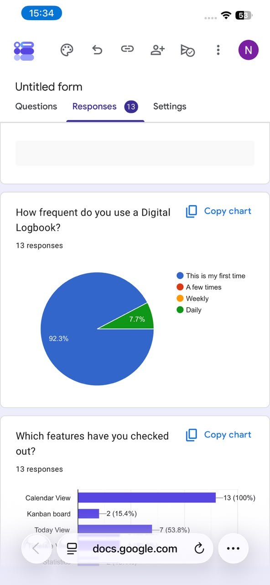
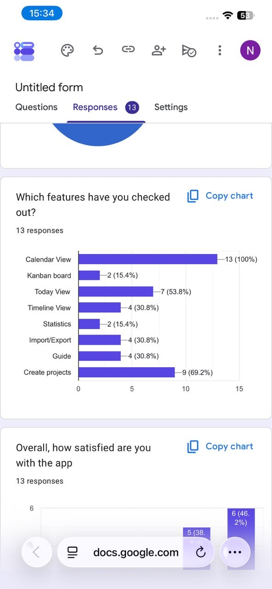
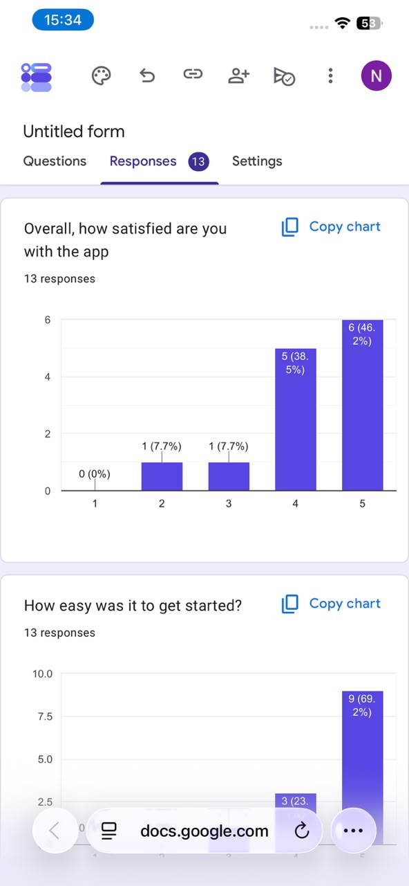
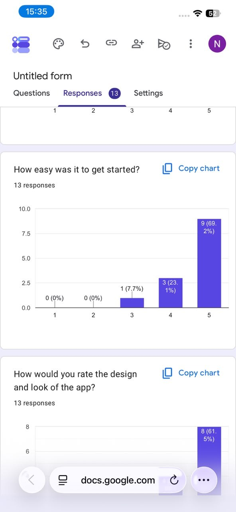
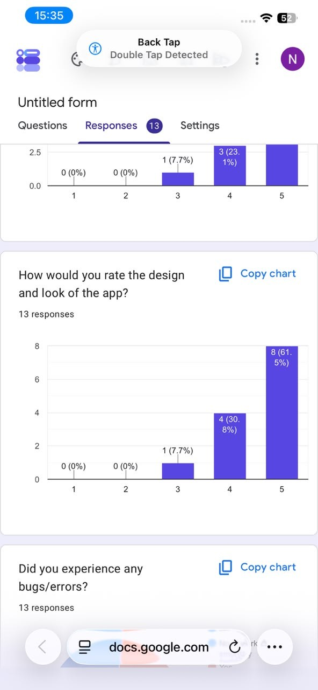
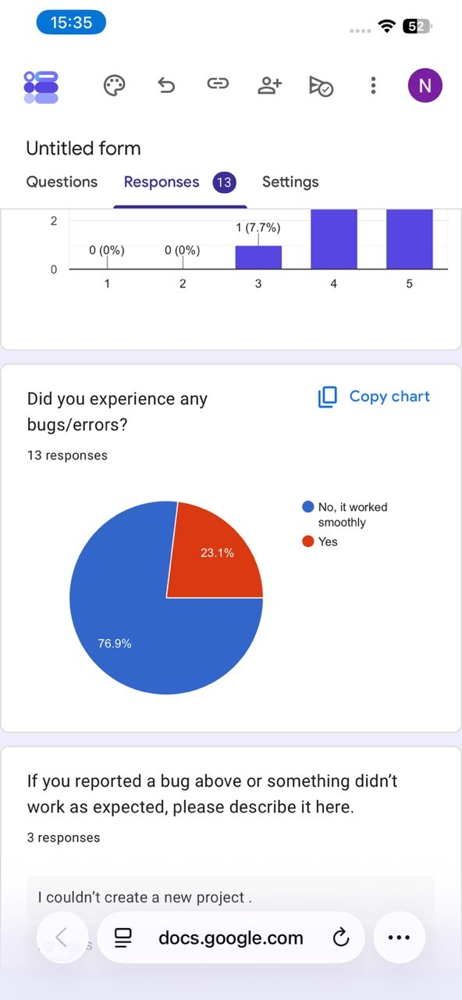
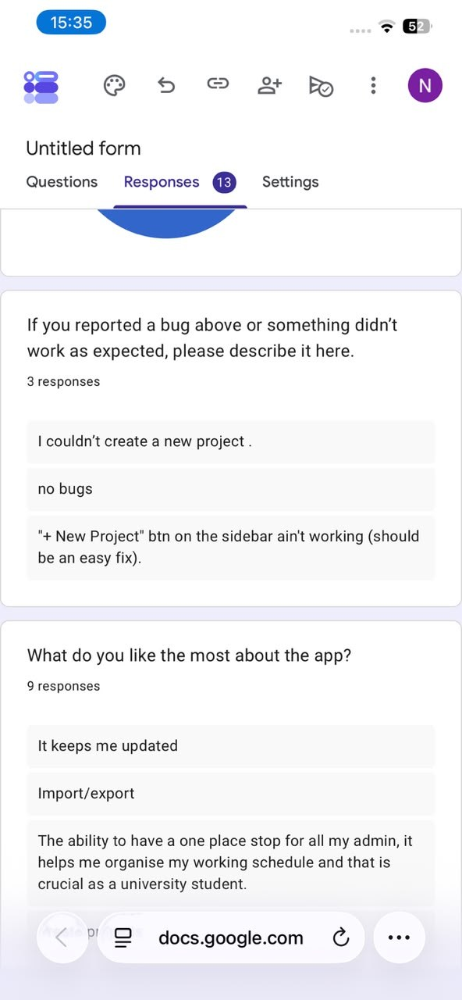
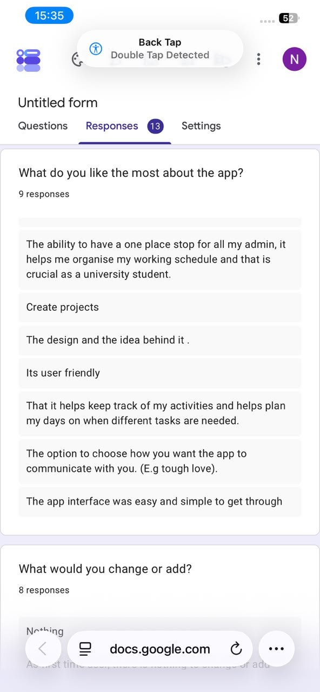
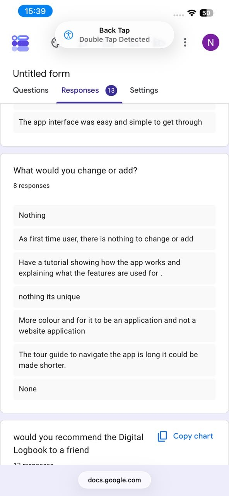
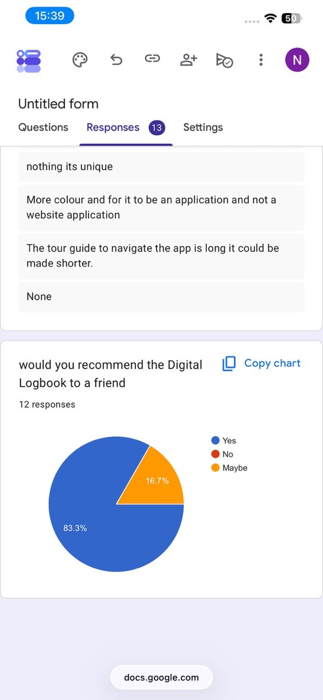

# User Feedback — Sprint 3 Survey

Following the Sprint 2 quick-survey round documented in
[Testing & User Feedback](testing.md#user-feedback-session-quick-survey-13-responses),
the team ran a second structured feedback round during Sprint 3 to check
whether the Sprint 2 fixes had landed and to guide the final polishing sprint.

**13 responses** were collected through a Google Form and reviewed on the
form's response dashboard. The screenshots below were captured from that
dashboard on **9 October 2026**.

!!! note "Privacy handling"
The original screenshots showed the form owner's student email address in the
Google Forms header. That personal contact detail has been redacted from the
published copies; the unmodified originals are preserved by the team and are
deliberately not published on this site.

---

## Methodology

| Property              | Value                                                                                                                                                                      |
| --------------------- | -------------------------------------------------------------------------------------------------------------------------------------------------------------------------- |
| **Instrument**        | Google Form (untitled), delivered via the Google Forms response dashboard                                                                                                  |
| **Responses**         | 13                                                                                                                                                                         |
| **Question types**    | Pie/multiple-choice (usage frequency, bugs, recommendation), 1–5 rating scales (satisfaction, ease of getting started, design), feature checklist, and open-text questions |
| **Evidence captured** | 10 dashboard screenshots, 9 October 2026                                                                                                                                   |
| **Free-text answers** | Bug descriptions (3 responses), likes (9 responses), change requests (8 responses)                                                                                         |

The survey intentionally repeated the shape of the Sprint 2 instrument —
quantitative rating scales first, open-text questions last — so the two rounds
can be compared at a glance.

---

## 1. Who Answered — Mostly First-Time Users

**Question:** _"How frequent do you use a Digital Logbook?"_ (13 responses)

| Answer                | Share          |
| --------------------- | -------------- |
| This is my first time | **92.3%** (12) |
| A few times           | 0%             |
| Weekly                | 0%             |
| Daily                 | 7.7% (1)       |

Almost the entire panel was trying the application for the first time, so this
round measures the **first-run experience** — onboarding, discoverability and
initial clarity — rather than long-term usage.

---

## 2. Feature Awareness — Calendar Universal, Kanban and Statistics Rarely Found

**Question:** _"Which features have you checked out?"_ (13 responses, multiple
choice)

| Feature         | Checked out   |
| --------------- | ------------- |
| Calendar View   | **13 (100%)** |
| Create projects | 9 (69.2%)     |
| Today View      | 7 (53.8%)     |
| Timeline View   | 4 (30.8%)     |
| Import/Export   | 4 (30.8%)     |
| Guide (tour)    | 4 (30.8%)     |
| Kanban board    | **2 (15.4%)** |
| Statistics      | **2 (15.4%)** |

**What this told us:** every respondent found the calendar and most found
project creation, but the Kanban board and the Statistics module were each
explored by only **two of thirteen** first-time users. The building blocks were
usable once found — the problem was **discoverability and navigation**, echoing
the "disconnected views" theme from the Sprint 2 survey (problem 1, issue #118)
and the client's Sprint 3 comment that the UI "isn't intuitive enough for new
users".

**How it connects to later work (verified in Git):** the
information-architecture rework at the Sprint 3/4 boundary — merged 29
September via PR
[#382](https://sdp.ms.wits.ac.za/codacaine/Digital-Logbook/pulls/382)
(commits `9a18ea6`, `319e98b`, `afbd72d`) with follow-through in PRs
[#383](https://sdp.ms.wits.ac.za/codacaine/Digital-Logbook/pulls/383)–
[#384](https://sdp.ms.wits.ac.za/codacaine/Digital-Logbook/pulls/384) on
1 October — rebuilt the dashboard around leading entry/project cards,
unified the Sort/View rows into dropdowns and consolidated the scattered
stats buttons. The public landing page + PLANNAR rebrand (PRs
[#397](https://sdp.ms.wits.ac.za/codacaine/Digital-Logbook/pulls/397)–
[#418](https://sdp.ms.wits.ac.za/codacaine/Digital-Logbook/pulls/418))
then gave first-time visitors an explicit feature overview before sign-up,
responding directly to the first-run discoverability gap this survey
measured.

---

## 3. Overall Sentiment — Positive Across All Rating Scales

| Question (1–5 scale)                    | Distribution                               | Mean  |
| --------------------------------------- | ------------------------------------------ | ----- |
| Overall, how satisfied are you?         | 5 → 6 (46.2%), 4 → 5 (38.5%), 3 → 1, 2 → 1 | ≈ 4.2 |
| How easy was it to get started?         | 5 → 9 (69.2%), 4 → 3 (23.1%), 3 → 1 (7.7%) | ≈ 4.6 |
| How would you rate the design and look? | 5 → 8 (61.5%), 4 → 4 (30.8%), 3 → 1 (7.7%) | ≈ 4.5 |

**84.6%** of respondents rated overall satisfaction 4 or 5, and no respondent
gave a 1 on any scale. Ease of getting started scored highest of the three
scales — evidence that the onboarding and guided-tour work shipped after the
Sprint 2 survey (problems 2 and 4, PRs #158, #161–165) had the intended
effect.

---

## 4. Bugs — Three Reports, Two About Project Creation

**Question:** _"Did you experience any bugs/errors?"_ (13 responses)

| Answer                 | Share          |
| ---------------------- | -------------- |
| No, it worked smoothly | **76.9%** (10) |
| Yes                    | 23.1% (3)      |

**Follow-up question:** _"If you reported a bug above or something didn't work
as expected, please describe it here."_ (3 responses, quoted verbatim)

> "I couldn't create a new project."

> "no bugs"

> "'+ New Project' btn on the sidebar ain't working (should be an easy fix)."

Two of the three concrete reports concerned **project creation**, and both
point at the same area: the "+ New Project" control in the old sidebar. This
was the single most actionable finding of the round.

**How it connects to later work (verified in Git):** the
`feat/remove-projects-sidebar` line of work reworked the navigation around
the problematic control and rebuilt entry/project creation as leading cards
on the dashboard (`9a18ea6`, `319e98b`, merged via PR
[#382](https://sdp.ms.wits.ac.za/codacaine/Digital-Logbook/pulls/382) on
29 September, with follow-through in PRs
[#383](https://sdp.ms.wits.ac.za/codacaine/Digital-Logbook/pulls/383)–
[#384](https://sdp.ms.wits.ac.za/codacaine/Digital-Logbook/pulls/384) on
1 October), and the New Project modal itself was fixed for mobile
(commit `469b91a`, "fix: improve New Project modal on mobile"). Because this
feedback arrived as anonymous free text, the fixes were verified through the
team's own regression testing rather than a re-survey of the same respondents.

---

## 5. What Testers Liked

**Question:** _"What do you like the most about the app?"_ (9 responses,
quoted verbatim)

- "It keeps me updated"
- "Import/export"
- "The ability to have a one place stop for all my admin, it helps me organise my working schedule and that is crucial as a university student."
- "Create projects"
- "The design and the idea behind it."
- "Its user friendly"
- "That it helps keep track of my activities and helps plan my days on when different tasks are needed."
- "The option to choose how you want the app to communicate with you. (E.g tough love)."
- "The app interface was easy and simple to get through"

The standout themes: the app as a **single organisational hub** (mentioned
three times in different words), **design**, **ease of use**, and the
**configurable communication tone** — a Sprint 1 feature ("tough love") that
testers still singled out as distinctive.

---

## 6. What Testers Would Change

**Question:** _"What would you change or add?"_ (8 responses, quoted verbatim;
the final response was cut off at the capture boundary and is not quoted)

- "Nothing"
- "As first time user, there is nothing to change or add"
- "Have a tutorial showing how the app works and explaining what the features are used for."
- "nothing its unique"
- "More colour and for it to be an application and not a website application"
- "The tour guide to navigate the app is long it could be made shorter."
- "None"

**Question:** _"Would you recommend the Digital Logbook to a friend?"_
(12 responses)

| Answer | Share          |
| ------ | -------------- |
| Yes    | **83.3%** (10) |
| Maybe  | 16.7% (2)      |
| No     | 0%             |

### How the change requests were handled

| Request                                   | Evidence-based status                                                                                                                                                                                                                                    |
| ----------------------------------------- | -------------------------------------------------------------------------------------------------------------------------------------------------------------------------------------------------------------------------------------------------------- |
| Tutorial explaining features              | **Already shipped** — guided tour with live navigation and voice narration (Sprint 2, PRs #158, #161–165). The request alongside it ("tour is long, make it shorter") is logged as backlog feedback; no tour-shortening change is evidenced in Sprint 4. |
| More colour                               | **Addressed** — the Sprint 4 PLANNAR rebrand and landing page rebuilt the visual identity with a warm palette, hero video and interactive cards (PRs #397–#418).                                                                                         |
| Native application instead of a web app   | **Out of scope** — recorded honestly as a platform request; no native build exists.                                                                                                                                                                      |
| "Nothing" / "None" / "nothing its unique" | Positive signal — 4 of 8 respondents had no change request.                                                                                                                                                                                              |

---

## Summary

| Metric                         | Value                                        |
| ------------------------------ | -------------------------------------------- |
| Responses                      | 13                                           |
| First-time users               | 92.3%                                        |
| Satisfaction ≥ 4               | 84.6% (mean ≈ 4.2 / 5)                       |
| Ease of getting started (mean) | ≈ 4.6 / 5                                    |
| Design and look (mean)         | ≈ 4.5 / 5                                    |
| Experienced bugs               | 23.1% (3 of 13)                              |
| Concrete bug reports           | 3 (2 about project creation)                 |
| Would recommend                | 83.3% Yes, 16.7% Maybe (of 12)               |
| Distinct improvement themes    | 3 (tutorial/tour length, colour, native app) |

### Feedback → Sprint 4 traceability

| Finding                            | Sprint 4 response (verified in Git)                                                                                                     | Status      |
| ---------------------------------- | --------------------------------------------------------------------------------------------------------------------------------------- | ----------- |
| "+ New Project" button unreachable | Creation flow reworked: leading entry/project cards (`9a18ea6`, `319e98b`; PR #382) + New Project modal mobile fix (`469b91a`; PR #383) | **Shipped** |
| Kanban/Statistics discoverability  | Navigation reworked — unified Sort/View dropdowns, consolidated stats controls (PR #382), landing-page feature overview (PRs #397–#418) | **Shipped** |
| Request for more colour            | PLANNAR rebrand + landing page visual identity (PRs #397–#418)                                                                          | **Shipped** |
| Tour too long                      | Logged; no tour-length change merged in Sprint 4                                                                                        | Backlog     |
| Native app request                 | Out of scope for a web-based course project                                                                                             | Not started |

The sentiment shift between rounds is worth noting: the Sprint 2 survey
surfaced seven distinct usability problems, while this round produced none of
comparable severity — the top free-text answers praised the app or asked for
additions rather than repairs, and bug incidence dropped to a single problem
area.

---

## Links

- [Sprint 2 feedback session (previous round)](testing.md#user-feedback-session-quick-survey-13-responses)
- [Sprint 3 user stories](../User_Stories/sprint-three.md)
- [Sprint 4 meetings — including the 8 October stress-test review](../Meetings/sprint-four-meetings.md)
- [Work Tracker](../Project_Management/work-tracker.md)
- [Roadmap](../roadmap.md)
